```markdown
# ☁️ Asistente Conversacional AWS Cloud Practitioner (CLF-C02) con Amazon Bedrock


Aplicación web conversacional especializada diseñada para apoyar a estudiantes en su preparación para la certificación **AWS Certified Cloud Practitioner (CLF-C02)**. Construida con **Streamlit**, conectada a modelos fundacionales a través de **Amazon Bedrock (`Converse API`)** y empaquetada con **Docker** para despliegue local seguro y reproducible.

---

## 📋 Tabla de Contenidos
- [Características Principales](#-características-principales)
- [Arquitectura y Flujo de Trabajo](#-arquitectura-y-flujo-de-trabajo)
- [Estrategia de Ingeniería de Prompts](#-estrategia-de-ingeniería-de-prompts)
- [Estructura del Proyecto](#-estructura-del-proyecto)
- [Requisitos Previos](#-requisitos-previos)
- [Configuración de Variables de Entorno](#-configuración-de-variables-de-entorno)
- [Despliegue Local con Docker (Recomendado)](#-despliegue-local-con-docker-recomendado)
- [Ejecución Local sin Docker (Desarrollo)](#-ejecución-local-sin-docker-desarrollo)
- [Plan de Validación y Pruebas](#-plan-de-validación-y-pruebas)
- [Seguridad y Buenas Prácticas](#-seguridad-y-buenas-prácticas)

---

## 🚀 Características Principales

* **Perfiles de Expertos Dinámicos:** El asistente adapta su comportamiento, tono y profundidad técnica según el dominio oficial del examen CLF-C02 seleccionado por el estudiante.
* **Integración Nativa con Amazon Bedrock:** Utiliza la `Converse API` de `boto3`, garantizando compatibilidad estandarizada con modelos fundacionales como **Amazon Nova 2 Lite** y **Anthropic Claude**.
* **Memoria Conversacional por Sesión:** Mantiene el contexto multi-turno mediante `st.session_state`, reiniciando automáticamente el historial al cambiar de perfil experto para evitar contaminación de contexto.
* **Autenticación Flexible:** Soporta credenciales estándar de AWS IAM / SSO (`AWS_ACCESS_KEY_ID`, `AWS_SECRET_ACCESS_KEY`, `AWS_SESSION_TOKEN`) así como autenticación mediante API Keys de Bedrock (`AWS_BEARER_TOKEN_BEDROCK`).
* **Monitoreo FinOps en Tiempo Real:** Visualiza la latencia por respuesta y el consumo acumulado de tokens de entrada y salida durante la sesión.
* **Contenerización Lista para Producción Local:** Imagen ligera basada en `python:3.11-slim` con *healthcheck* integrado e inyección segura de variables en tiempo de ejecución.

---

## 📐 Arquitectura y Flujo de Trabajo

El diseño del sistema abarca el flujo completo desde la definición de la estrategia pedagógica de *prompts*, pasando por la arquitectura modular de software, hasta la validación funcional con Amazon Bedrock:

```mermaid
flowchart LR
    subgraph F1 ["1. Estrategia de Prompts (src/prompts.py)"]
        P1[Dominio 1: Conceptos Cloud]
        P2[Dominio 2: Seguridad IAM/KMS]
        P3[Dominio 3: Servicios Core]
        P4[Dominio 4: FinOps y Precios]
        P5[Simulador Examen CLF-C02]
    end

    subgraph F2 ["2. Aplicación en Contenedor Docker"]
        UI[Interfaz Web Streamlit<br/>src/app.py]
        State[Gestión de Sesión<br/>st.session_state]
        Client[Cliente Bedrock Runtime<br/>src/bedrock_client.py]
        Env[Variables de Entorno<br/>.env / Docker --env-file]
    end

    subgraph F3 ["3. Nube AWS & Validación"]
        IAM[Validación IAM / SSO / API Key]
        Bedrock[Amazon Bedrock<br/>Converse API]
        LLM[Modelo Fundacional<br/>Amazon Nova 2 Lite]
    end

    F1 -->|System Prompt| UI
    UI <-->|Historial Multi-turno| State
    UI -->|Mensajes + Perfil| Client
    Env -.->|Inyección Segura| Client
    Client --> IAM --> Bedrock <--> LLM
    Bedrock -->|Respuesta + Métricas| Client
    Client --> UI

```



---

## 🧠 Estrategia de Ingeniería de Prompts

Antes de implementar la capa técnica, se diseñó una arquitectura de *System Prompts* alineada con los **4 dominios oficiales de la guía del examen AWS CLF-C02**, complementada con reglas estrictas de comportamiento (*guardrails*):

| Perfil de Experto | Dominio CLF-C02 | Enfoque Pedagógico |
| --- | --- | --- |
| **🏛️ Arquitecto Cloud** | **Dominio 1:** Conceptos de la Nube (24%) | Ventajas de la nube (CAPEX vs OPEX), *AWS Well-Architected Framework* (6 pilares), *Cloud Adoption Framework (CAF)* y modelos de despliegue. |
| **🛡️ Especialista en Seguridad** | **Dominio 2:** Seguridad y Cumplimiento (30%) | *Modelo de Responsabilidad Compartida*, IAM (usuarios, grupos, roles, políticas, MFA), KMS, WAF, Shield, GuardDuty, Macie y Artifact. |
| **⚙️ Ingeniero de Servicios Core** | **Dominio 3:** Tecnología y Servicios (34%) | Arquitectura global, cómputo (EC2, Lambda, ECS), almacenamiento (S3, EBS, EFS), redes (VPC, Security Groups vs NACLs) y bases de datos (RDS, DynamoDB). |
| **💰 Consultor FinOps** | **Dominio 4:** Facturación y Precios (12%) | Modelos de compra EC2 (On-Demand, Savings Plans, Reserved, Spot), *Pricing Calculator*, *Budgets*, *Cost Explorer*, *AWS Organizations* y planes de soporte. |
| **📝 Evaluador de Examen** | **Transversal (Simulador)** | Genera preguntas de opción múltiple (A, B, C, D) basadas en escenarios reales, espera la respuesta del estudiante y explica por qué cada opción es correcta o incorrecta. |

**Guardrails aplicados a todos los perfiles:**

1. Respuestas estructuradas en español utilizando formato Markdown (tablas comparativas, listas y negritas).
2. Restricción de dominio: redirección amable si el usuario consulta temas ajenos a AWS o computación en la nube.
3. Parámetros de inferencia controlados (`temperature: 0.4`, `topP: 0.9`, `maxTokens: 1200`) para priorizar precisión técnica y evitar alucinaciones.

---

## 🗂️ Estructura del Proyecto

```text
s2026-q4_c-llmbedrock-DavidTorres/
├── .dockerignore          # Excluye .env, .git y entornos virtuales de la imagen Docker
├── .env.example           # Plantilla pública de variables de entorno requeridas
├── .gitignore             # Protege el repositorio evitando subir credenciales (.env)
├── Dockerfile             # Definición de imagen Docker lista para despliegue local
├── README.md              # Documentación técnica, diagramas y guía de uso
├── requirements.txt       # Dependencias exactas de Python
└── src/
    ├── __init__.py        # Inicializador del paquete Python
    ├── app.py             # Interfaz conversacional en Streamlit y control de sesión
    ├── bedrock_client.py  # Lógica de conexión e invocación a Amazon Bedrock
    └── prompts.py         # Definición modular de perfiles expertos y guardrails

```

---

## 📌 Requisitos Previos

* **Cuenta de AWS** con acceso habilitado a **Amazon Bedrock** en la región seleccionada (ej. `us-east-1`) y permisos `bedrock:InvokeModel` sobre el modelo configurado.
* **Docker Desktop** o **Docker Engine** instalado y en ejecución (para despliegue contenerizado).
* **Python 3.11+** (opcional, únicamente si deseas ejecutar la aplicación fuera de Docker).

---

## ⚙️ Configuración de Variables de Entorno

1. Crea tu archivo local `.env` a partir de la plantilla pública `.env.example`:
```bash
cp .env.example .env

```


2. Edita el archivo `.env` y completa tus credenciales según tu método de autenticación en AWS:
```env
# Opción 1: Credenciales AWS IAM / SSO
AWS_ACCESS_KEY_ID=tu_access_key_aqui
AWS_SECRET_ACCESS_KEY=tu_secret_key_aqui
# Opcional: requerido únicamente si utilizas credenciales temporales (ej. AWS SSO / AWS Academy)
AWS_SESSION_TOKEN=tu_session_token_aqui

# Opción 2: API Key de Amazon Bedrock (descomentar si no usas llaves IAM)
# AWS_BEARER_TOKEN_BEDROCK=tu_api_key_de_bedrock_aqui

# Configuración del servicio y modelo fundacional
AWS_REGION=us-east-1
MODEL_ID=global.amazon.nova-2-lite-v1:0

```


---

## 🐳 Despliegue Local con Docker (Recomendado)

1. **Construir la imagen Docker:**
Desde la raíz del repositorio, ejecuta:
```bash
docker build -t s2026-q4_c-llmbedrock-davidtorres .

```


2. **Ejecutar el contenedor inyectando las variables de entorno:**
```bash
docker run -d --name aws-clf-tutor -p 8501:8501 --env-file .env s2026-q4_c-llmbedrock-davidtorres

```


3. **Verificar que el contenedor esté activo:**
```bash
docker ps

```


4. **Acceder a la interfaz web:**
Abre tu navegador en: 👉 **[http://localhost:8501](http://localhost:8501)**
5. **Comandos útiles de administración del contenedor:**
* Ver registros en tiempo real: `docker logs -f aws-clf-tutor`
* Detener y eliminar el contenedor: `docker stop aws-clf-tutor && docker rm aws-clf-tutor`


---

## 💻 Ejecución Local sin Docker (Desarrollo)

Si deseas ejecutar la aplicación directamente en tu entorno local de Python:

1. **Crear y activar un entorno virtual:**
```bash
python -m venv .venv
source .venv/bin/activate        # En Linux / macOS
# .venv\Scripts\Activate.ps1     # En Windows PowerShell

```


2. **Instalar dependencias:**
```bash
pip install -r requirements.txt

```


3. **Iniciar la aplicación Streamlit:**
```bash
streamlit run src/app.py

```
